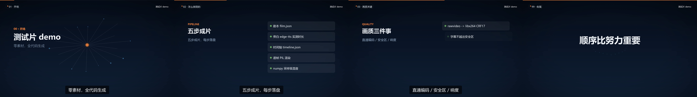
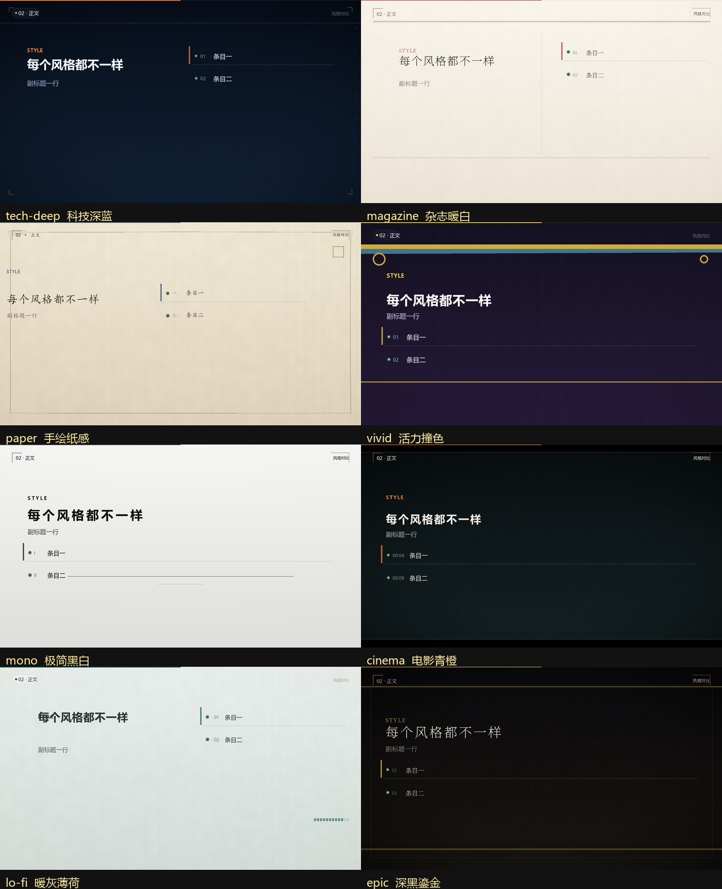
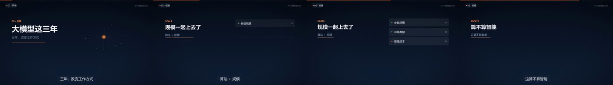
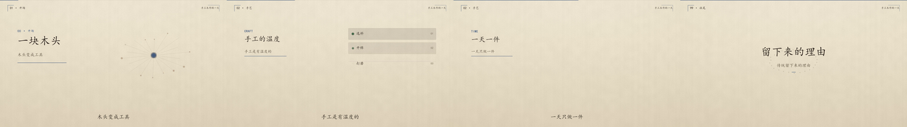
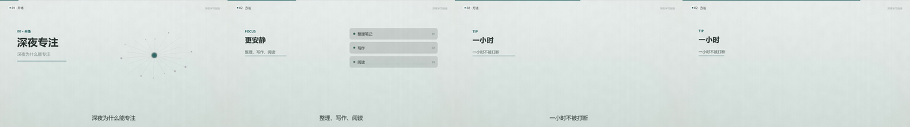

# @dsh-gis/dsh-video-studio-skill

 

**DeepSeek Harness 技能插件：用代码从零生成中文视频。**

写剧本 → edge-tts 旁白 → **实测时长**排时间轴 → **提示点**驱动配乐与音效 → PIL 或浏览器逐帧渲染 →
ffmpeg 编码 → 采样级混音 → **四层质检**（容器 / 信号 / 时间 / 页面）+ **v0.8 的四个新闸**
（渲前资源预检 `G0` / 词级时间戳 `G10` / 全片 VMAF `G11` / ASR 回读 `G12`）。
零素材、可复现、可断点续跑、可脚本化验收；装成插件后，整片生产流程随技能一起进入每个会话。

> 源自 `dsh-v` 资产包的 `02-技能包-video-studio`（817 个 DSH 会话的考古分析 + 5 套现存工程逆向 + 本机实测）。
> **v0.2.0**：用这套技能真的做出一部 11 分钟成片后，发现 10 处"文档承诺了、代码没做到"的地方
> （门禁失效、缓存不校验、stage 假独立、mux 二次编码等），全部修掉并补了 14 条回归断言。
> **v0.3.0**：与另一部 6 分半成片（`ai-history-film`）对照后，补上本项目最缺的四块——
> 物理建模音效库、程序化配乐、浏览器逐帧渲染引擎、帧级质检，以及把三者串起来的**提示点系统**。
> **v0.4.0**：修掉 4 处"门禁看着干净、其实没在查"的静默问题（`--resume` 复用旧分块、
> `music.mode=off` 仍混入旧配乐、PIL 路线音画同步恒空、亮度静止判据误报 4 段），
> 补上仓库级体检（`tools/ci_check.py`）、CI、`requirements.txt`，并修掉管道中文乱码。
> **v0.5.0（风格包）**：解决"每部片都长一个样"。一个 `style` id 同时决定画风（8 套主题 ×
> 3 种版式）、配乐（8 套风格：调池/BPM 梯度/进行/动机/配器/鼓型）、旁白（9 个声线 × 6 档语气）
> 与节奏；`"style": "auto"` 按内容自动选，三级内容指纹保证"改错别字不换整首曲子"。
> 不写 `style` 字段 = v0.4 行为（配乐 PCM 逐样本一致，selfcheck 有断言）。
> **v0.6.0（交付可信化）**：解决"**质检结论只活在控制台里**"。新增门禁账本与机读交付报告
> `out/QC-REPORT.md`（gate matrix 分 **pass / fail / skipped 三档**——"没执行"不再冒充"通过"）、
> 人工签核 `--stage accept`（绑内容指纹，改了剧本旧签核自动失效）、阶段新鲜度 `--stage explain`
> （改上游后哪些产物还是旧的、最小重跑什么）、开渲前成本预演 `tools/estimate.py`、
> `film.json` 契约校验 `filmcheck.py`（改成 `holds` 这种拼写错误不再静默失效）。
> 顺手修掉一个**已发布版本里的真 bug**：`--jobs >1` 并行渲染因主题色元组被 JSON 变成 list 而直接崩溃
> ——也就是 README 下面教的"长片分块并行"此前根本跑不通。
> 详见 [CHANGELOG.md](CHANGELOG.md)、SKILL.md §7.0 与 references/change-impact.md。
> **v0.7.0（声音也不再一片一样）**：内容指纹从 seed 推进到**结构层**——和弦替换、进行档位、动机偏移、
> 鼓型 ghost 都随内容变化；音效 seed 改内容派生并跟随配乐调性（`in_key`）；段落边界前 2.2 s 的
> whoosh/riser 自动 -3 dB，避免与配乐过门撞车；duck 按风格加深到 3.0–5.5 dB。legacy 路径逐样本不变。
> **v0.7.1（旁白优先）**：配乐基线从 -1.5 降到 **-12 dB**，有人声处再按包络压配乐 6 dB / 音效 3 dB，
> 混音后按台词活跃区实测旁白/背景差，**不足 12 dB 自动补压背景**（`guard_snr_db`，最多 30 dB）。
> 实测（真实素材）：旧混音 -4.2 dB → 新混音 12.0 dB，`audio_similarity --strict` D 组 12.9 dB；
> selfcheck 34 → 38 条，其中第 35–38 条专盯这条链路。
> 详见 [CHANGELOG.md](CHANGELOG.md) 与 SKILL.md §5.6 / §5.7、references/audio-variation.md。
> **v0.8.0（把"看得见"变成"抓得住"）**：四个方向——① **词级时间轴**：edge-tts 的 WordBoundary 事件落
> `work/words.json`（4 句 / 64 词 / 末词偏差 0.09 s），字幕改按词折行，cue 可写词锚点 `"l03:w2+0.1"`；
> ② **四道新门禁**：渲前资源预检 `G0`（缺字形/坏音频在渲第一帧前 fail，< 1 s）、词级时间戳 `G10`、
> 全片 VMAF/SSIM `G11`（参考帧由场景函数**实时重渲**，不是成片抽帧；29 s 片 VMAF 97.22 / 14.2 s）、ASR 回读 `G12`
> （成片音轨转文字对账，0.72 以下才 fail，8.7 s/片）；③ **画幅/帧率参数化**（只做 16:9 横屏，
> 内部恒 1080p、编码时下采样，720p 已实测全门通过）、**批量** `--batch`（≤100 条、开跑前全量预检、
> 单条失败不阻断）、**预览** `--preview N`（前 N 秒出 mp4+gif）、**运行版本化** `--run-id`（`work/runs/<runId>/`）；
> ④ web 引擎跟随风格包（`window.__STYLE__` 注入，`style=None` 时逐字节等于 v0.7）+ 金帧像素回归
> `tools/golden_frames.py`。**代价要说清**：29 s 模板片全链从约 28 s 涨到 **47.3 s**，其中 `qa` **23.9 s**
> 已经**超过渲染本身**（`frames` 12.5 s）；`estimate` 预演也从 28.4 s 变成 **58.8–108.2 s**（vmaf 31–50 s 是瓶颈）。
> v0.8 之后"出片时间"不再只是渲染时间。selfcheck 43 → **51 条**。
> 详见 [CHANGELOG.md](CHANGELOG.md) 与 SKILL.md §6.1 / §7.5、references/word-timeline.md、references/v08-quality.md。
> **v0.8.1（全项目深审，无新功能）**：把 14 个模块 / 5 个前端文件 / 12 篇 references / 仓库工具链
> 全部过一遍，修掉 **60+ 处**「看着没问题、其实没在查」。举几个真会伤到交付的：
> ① **VMAF 参考帧与成片的字幕折行口径不一致**（渲染传 `words`、参考帧没传）——近静态画面
> 从 **99.95 掉到 8.55**，同源好片被判 fail；② `--stage style/stills/frames/mux` 的门禁 fail
> **没进退出码**（stdout 打 [FAIL]、进程仍 exit 0）；③ `webengine` 在 `style=None` + 720p 时
> **静默输出 1080p 原画的左上角裁切**（逐像素相同、标题/HUD 全丢、exit 0）；
> ④ `visual.layout` 与 `qa.vmaf.sample_step` 写了**完全没人读**；⑤ `selfcheck` 第 51 条把金帧
> 的 skipped 当 PASS（**这条门禁从没真的比过一帧**）；⑥ `ci_check` 把"跳过（没装 node）"记成 PASS。
> 详见 [CHANGELOG.md](CHANGELOG.md) 的 0.8.1 段（含行为变化表与升级须知）。
> **v0.9.0（换风格不再只是换色）**：v0.5 的风格包只覆盖"皮肤"（配色/字体/纹理/字距/缓动），
> 8 套风格共用同样的构图骨架，用户反馈"每个视频都差不多，只是主题和颜色不同"。
> v0.9 把这条链路拆成三层：**场景语法**（按内容选 10 类构图：hero / statement / list / stat /
> compare / process / quote / chapter / chart / outro，落 `work/storyboard.json` 可审计）、
> **视觉语言包**（每套风格补五组结构签名：motion / motif / transition / typography / bias，
> 母题预烘焙并合成进背景底版，逐帧只 copy/EXTENT）、**片内编排**（版式变体 / 装饰密度 / 相位偏移，防"复印"）。
> 新门禁 **G13 剪影可区分**（`tools/silhouette_qa.py`）：8 套风格两两 **28 对全部通过**，
> 改造前同明暗族 12 对只过 8 对。**代价如实说**：模板片 frames 约 **19 ms/帧（54–61 fps）**，
> 仍在 25 ms 预算内，但比 v0.8.1 的约 13 ms/帧（约 75 fps）慢——慢在 10 类构图各自多了装饰与几何。
> 0.9.1 已经把装饰母题从"逐帧 paste（实测 5.6 ms）"改成"烘焙进背景底版（1.3–2.0 ms）"，
> 这也是它比 0.9.0 首版快回来一截的原因。web 引擎本次不跟随场景语法；
> legacy（不写 `style`）仍逐字节不变。selfcheck 51 → **55 条**。
> **v0.9.1** 把"逐帧全屏贴装饰"（实测 5.6 ms/帧）改成"装饰烘焙进背景底版"（1.3–2.0 ms），
> 顺带让装饰跟着镜头缓推一起动（cinema / epic 的强 push 下不再穿帮）。
> 详见 [CHANGELOG.md](CHANGELOG.md) 的 0.9.0 / 0.9.1 段与
> [references/scene-grammar.md](skills/video-studio/references/scene-grammar.md)。

## 安装

桌面版：插件管理器 → 填 `@dsh-gis/dsh-video-studio-skill`（或本地目录 `D:\self\code\dsh-video-studio-skill`）

命令行：

```bash
dsh plugin --profile desktop add "@dsh-gis/dsh-video-studio-skill"
# 本地调试（不发布也能装）：
dsh plugin --profile desktop add "D:/self/code/dsh-video-studio-skill"
```

安装后在「插件」页启用 `video-studio` 这一行，新开会话即可在技能目录看到 **video-studio**。

### 与手工技能目录的关系

技能按 rank 解析：`~/.dsh/skills`（rank 400）**优先于**插件提供的 bundled 技能根（rank 600）。
如果你之前手工装过 `~/.dsh/skills/video-studio`，它会把插件版本遮住。装好插件后**把旧目录移出 `~/.dsh/skills` 根目录**（只改名不够——扫描认的是 `<root>/<name>/SKILL.md`，`.bak` 后缀的目录照样会被扫到）：

```bash
mkdir -p ~/.dsh/backup
mv ~/.dsh/skills/video-studio ~/.dsh/backup/video-studio.bak-$(date +%Y%m%d)
```

需要回滚时把目录移回 `~/.dsh/skills/video-studio` 即可。

## 效果（不是渲染出来的"宣传图"，是默认模板片的真实抽帧）

<p align="center"></p>

上面四帧是用仓库自带的 `assets/film.json` + `assets/scenes.py` 从零跑一遍 `python render.py` 的
`work/qa/sheet.png`，未经任何修图。配套实测（**作者机器** Windows 11 / OSGeo4W Python 3.12，
v0.6 时期口径；TTS 实测时长与 AAC 编码会让这些数字在小范围内浮动，换机请按 SKILL.md §14 重测）：
**时长 30.10 s / 1920×1080 / 30 fps / h264+aac 48 kHz / -16.0 LUFS / 真峰 -1.2 dBTP / 黑帧 0 /
帧级深检：闪烁 0、空窗 0、画面静止 0**（音画同步在 PIL 路线上需要写 `visual_at` 才会真的查，见 SKILL.md §7）。

怎么复现：按 [SKILL.md §1](skills/video-studio/SKILL.md) 的五步上手，把自带模板拷到**空目录**里跑一遍即可
（`cp assets/film.json assets/scenes.py` + 拷 `scripts/*.py` → `python render.py`）。数字每次都会差一点：
TTS 实测时长、AAC 编码都会让真峰/响度/锐度浮动，**别 chasing 小数点**。本机（另一台）复测同模板得到的是
29.00 s / -16.5 LUFS / -1.4 dBTP / 锐度比 1.01（2026-11-10 另一台 Windows 机器复测）——
**不同机器、不同 TTS 结果，两组都对，别混着引用**。

## 效果：同一个模板，八种气质（v0.5 → v0.9）

同一份文字、同一个场景类型（`list`），只改 `"style"`。**v0.9 起不只是换色**：
每套风格有自己的装饰母题（括角 / 手绘框 / letterbox / 信号条 / 放射线…）、
字距与编号写法、段界转场、整体重心偏移，所以同一屏的骨架与留白也不同：

<p align="center"></p>

> 这张图是 v0.9 用新代码重渲的（8 套风格 × 同一段内容），**换图不是换滤镜**：
> 标题锚点、装饰语言、编号写法、重心都在变。要看"这一段为什么画成这样"，
> 跑 `--stage style` 会打印视觉语言（母题/转场/字距/编号/重心），
> 跑 `--stage layout` 会打印分镜（每段选哪类构图、为什么）并落 `work/storyboard.json`。

三份**不同题材**的短片（全流程真跑：TTS → 排轴 → 配乐 → 音效 → 混音 → 逐帧 → 编码 → 质检；数据见
`docs/styles/demo-results.json`，是 v0.5 时期的实测快照，片源脚本未随仓库分发，**不可直接复现**；
**别把这张表当成"现在跑出来就是这样"**——BPM/调性由内容指纹从风格梯度里选（v0.7 起指纹还参与配乐结构），
同一题材换一版正文就可能落到别的 BPM/调性，当前风格解析结果请以 `--stage style` 的打印为准）：

| 题材 | 自动选中的风格 | 配乐 | 旁白声线 | 质检 |
|---|---|---|---|---|
| AI 大模型的三年 | tech-deep 科技深蓝 | 小调 116BPM / Em | 青年开场 → 男声正文 → 女声引用 | PASS（17.3s，-16.0 LUFS） |
| 手工木作的一天 | paper 手绘纸感 | 大调 88BPM / G | 女声 + 软糯女声正文 | PASS（19.9s） |
| 深夜学习指南 | lo-fi 暖灰薄荷 | 大调 84BPM / F | 温柔女声 + 女声开场 | PASS（20.1s） |

<p align="center"></p>

三片的联系表（左→右为时间顺序）肉眼可见不是同一套风格：深蓝科技 / 牛皮纸手作 / 冷灰薄荷深夜。

## 用法

触发词：做一个视频 / 生成宣传片 / 把报告变成视频 / 做动画 / 配音配字幕 / 出成片 /
修视频音画不同步 / 视频画质糊，或提到 ffmpeg、edge-tts、逐帧渲染、字幕、分镜、配乐、混音。

最短路径（技能 `SKILL.md` 第 1 节有完整版）：

```bash
mkdir -p myfilm && cd myfilm
cp <SKILL_DIR>/assets/film.json .                       # 剧本模板（"style": "auto"）
cp <SKILL_DIR>/assets/scenes.py .                       # 场景模板
cp <SKILL_DIR>/scripts/*.py .                           # filmkit/stylekit/voicekit/render/selfcheck + sfxkit/scorekit/qa_frames/webengine
                                                         #   v0.8 还含 preflight/qaasr/qavmaf（可选：缺了对应门禁记 skipped）
cp -r <SKILL_DIR>/assets/web ./web                       # 只在走浏览器引擎时需要

python selfcheck.py                                     # 55 条环境/回归断言（20 秒内，不联网）
python <REPO>/tools/estimate.py --script film.json       # v0.6：开渲前先算耗时/磁盘/分块（仓库/包里的工具，
                                                         #     不在 skills/video-studio/ 内，quickstart 拷出来的目录没有它）
                                                         #     v0.8：已含 preflight/vmaf/asr 三段；29 s 模板片
                                                         #     预演 total 28.4 s -> 37.5-83.0 s（区间上界，实测 47.3 s）
python render.py --stage stills --stills "l01:3,l02:5"  # 母版预览（缺 tts/layout 会自动补跑）
python render.py --script film.json --scenes scenes.py --out out/film.mp4 --work work
cat out/QC-REPORT.md                                    # v0.6：机器可读交付结论（pass/fail/skipped）
python render.py --stage accept --gate release          # v0.6：人工签核（绑内容指纹）
```

分阶段（每步落盘、可单独重跑）：

```
tts → layout → cues → score → sfx → audio → frames → mux → qa
```

**三种玩法**：

| 想要 | 怎么做 |
|---|---|
| 只加"该响的地方响一下" | 写 `film.json` 的 `sfx.cues` 或 `scenes.py` 的 `cues()` 钩子 → `--stage cues sfx audio` |
| 整片要一段像样的配乐 | 设 `bpm` / `music.mode=score` → `--stage score` |
| 画面要粒子/形变/着色器 | `--engine web` + 拷 `assets/web/`，改页面里的场景代码 |

**v0.4 的两个新开关**（都是"让门禁真的会失败"，不是新玩具）：

| 想要 | 怎么做 |
|---|---|
| 让 PIL 路线的音画同步门禁真的生效 | cue 加 `"visual_at": 绝对秒`；再把 `QA_REQUIRE_SYNC=1` 加进你自己的交付流水线（本仓库的 workflow 没设它） |
| 浏览器渲染要跨会话字节级可复现 | `--deterministic`（或 `WEBENGINE_DETERMINISTIC=1`），代价约 +22%/帧 |

`<SKILL_DIR>` 是 `skill` 工具加载时回报的 resourceBase 目录（`.../skills/video-studio/`）；
`<REPO>` 是包根（仓库根，或装好后 profile 里的 `node_modules/@dsh-gis/dsh-video-studio-skill/`），即 `<SKILL_DIR>` 往上两级——`tools/`、`schemas/` 都在 `<REPO>` 下，`cp` 到 `myfilm/` 后那里**没有** `tools/`。

分阶段（v0.2 起**每个 stage 只做自己的事**）：`--stage style | tts | layout | cues | score | sfx | audio | frames | mux | qa | stills | accept | explain`。

**v0.6 的三个新开关**（都是"让结论可追责"，不是新玩具）：

| 想要 | 怎么做 |
|---|---|
| 交付前把"没执行"也算失败 | `--stage qa --strict-gates`（对齐 `QA_REQUIRE_SYNC` 语义） |
| 改完东西不知道要重跑什么 | `--stage explain`（机器判断过时阶段 + 给最小重跑命令），表见 [references/change-impact.md](skills/video-studio/references/change-impact.md) |
| 规整 `film.json` 避免静默失效 | `python skills/video-studio/scripts/filmcheck.py film.json`（`holds`→提示写成 `hold`） |

**v0.8 的四个新开关**（前三个会改变门禁结果，第四个只是看片更快）：

| 想要 | 怎么做 |
|---|---|
| 交付 720p / 换帧率 | `film.json` 写 `"video": {"width":1280,"height":720,"fps":24}`（只做 16:9 横屏、只能下采样；720p 已实测全门通过） |
| 批量出片 | `python render.py --batch films.json`（≤100 条、开跑前全量预检、单条失败不阻断、末尾 `batch-report.json`） |
| 只渲前 N 秒给人看 | `--preview 15`（出 `out/preview/*.mp4` + `.gif`，不写交付账本） |
| 让 QA 快一点 | `--vmaf sample`（每 5 帧取 1，实测 8.0 s vs 全片 14.2 s，VMAF 只差 0.34）或 `--vmaf off`（G11 记 skipped） |

长片：`--stage frames --jobs 4`（按绝对帧号分块并行）+ `--resume`（中断只补缺块）。

## 这个技能解决什么

| 铁律 | 怎么保证 |
|---|---|
| 音画不同步 | 时间轴由 TTS **实测时长**反推，绝不按字数估算 |
| 文字发虚 | PIL 帧走 `rawvideo` 直通 libx264，不用 cv2 中间文件二次压缩 |
| 后半段静音 | numpy 采样级混音，不用一条 ffmpeg 命令喂上百个输入 |
| 该有的淡入/字幕静默消失 | 质检门禁查"必须有"和"不能有"两类断言 |
| 成片"像草稿" | -16 LUFS / 真峰 ≤ -1 dBTP / 编码锐度比 ≥ 0.85 |
| **声音和画面对不上（v0.3）** | **提示点系统**：画面登记 cue → 音效按 cue 合成，改节奏不用重新对时间 |
| **声音单薄、只有"叮叮咚咚"（v0.3）** | `sfxkit` 物理建模音效 + `scorekit` 一张和弦表贯穿全片 |
| **一帧白闪/两秒空窗没人发现（v0.3）** | `qa_frames` 帧级深检：单帧闪烁、画面空窗、音画同步 |
| **"我查过了"无法复现（v0.6）** | `out/QC-REPORT.md` + `work/gates.json`：三档 gate matrix，"没执行"独立成 `skipped` |
| **"我签过了"变成空头支票（v0.6）** | 签核绑内容指纹：改剧本 / `scenes.py` / 引擎，旧签核自动失效 |
| **改一句台词不知道要重跑什么（v0.6）** | `work/manifest.json` 记每阶段输入/输出指纹，`--stage explain` 直接给最小重跑命令 |
| **`holds` 写成拼写错误却静默失效（v0.6）** | `schemas/film.schema.json` + `filmcheck.py`，并接进 `ci_check` 第 12 项 |

## 文件结构

```
index.js                     插件入口：把 skills/ 挂成 bundled 技能根
cordis.patch.yml             组合包 patch（insert: video-studio）
icon.svg / locale/*.json     插件页展示元数据
skills/video-studio/
  SKILL.md                   主线：上手 / 八阶段 / 引擎选型 / 画质 / 声音 / 提示点 / 停留窗口 / 质检 / 故障速查
  references/                pipeline · scene-authoring · audio · audio-variation · sfx-design · web-engine
                             frame-qa · quality-gates · change-impact · style-packs · pitfalls
                             word-timeline（v0.8）· v08-quality（v0.8）
  scripts/filmkit.py         生产内核（字体/排版/字幕/音频总线/CueBus/TTS/时间轴/编码/质检）
  scripts/gates.py           v0.6 门禁账本 / QC 报告渲染 / 人工签核（绑内容指纹）
  scripts/stagewatch.py      v0.6 阶段新鲜度（work/manifest.json + --stage explain）
  scripts/filmcheck.py       v0.6 film.json 契约校验（未知键/枚举/跨字段）
  scripts/render.py          编排器（13 个 stage、pil|web 双引擎、分块并行、断点续跑、母版预览、门禁账本；
                             v0.8 增 --batch / --preview / --run-id / --vmaf / --no-preflight）
  scripts/preflight.py       v0.8 渲染前资源预检（字形 / TTS 音频 / 字体 / web 入口页，门禁 G0）
  scripts/qavmaf.py          v0.8 全片 VMAF/SSIM（参考帧由场景函数实时重渲，门禁 G11）
  scripts/qaasr.py           v0.8 ASR 回读（成片音轨转文字对账，门禁 G12）
  scripts/selfcheck.py       回归自检（55 条"曾真的坏过"的断言）
  scripts/sfxkit.py          物理建模音效库（24 配方，scipy 可选）
  scripts/scorekit.py        程序化配乐（和弦表 / 分段能量 / 吸气）
  scripts/webengine.py       浏览器逐帧渲染（CDP 截图、分块并行、崩溃重开、cue 导出、文字质检）
  scripts/qa_frames.py       帧级深检（单帧闪烁 / 画面空窗 / 画面静止 / 音画同步 / 亮度响度曲线）
  requirements.txt           Python 依赖（必需 / 强烈建议 / 可选三档，带注释）
  assets/film.json           剧本模板（含 bpm / music / sfx.cues / 逐句 hold；顶层 hold 可选，缺省用风格 pacing）
  assets/scenes.py           场景模板（开场 / 正文卡片 / 收尾 + cues() 钩子）
  assets/golden_frames.json  v0.8 金帧基线（3 帧 sha256 + 字体/环境指纹，改绘制代码后重录）
  assets/web/                浏览器页面模板（原生 Canvas2D 确定性时间轴；v0.8 读 window.__STYLE__）
tools/ci_check.py            仓库级体检（12 项；语法/JSON/依赖白名单/打包卫生/文档引用/film 契约，不需 ffmpeg）
tools/estimate.py            开渲前成本预演（帧数/耗时/磁盘/分块建议，--json 可机读；v0.8 含 preflight/vmaf/asr）
tools/golden_frames.py       v0.8 金帧像素回归（--write 重录 / --check 校验；同环境像素变了 = fail）
tools/audio_similarity.py    音频差异/相似度验收（--strict 阈值判定，改音频代码后必跑）
tools/selftest_noscipy.py    无 scipy 兜底路径自检（CI 用；屏蔽 scipy 后跑 sfxkit/scorekit 自检）
schemas/film.schema.json     film.json 的契约（draft-07 子集）
.github/workflows/ci.yml     CI：repo 体检（ubuntu+windows）+ 技能自检（ubuntu）
```

## 环境前提

**插件运行**：Node.js ≥ 20（`package.json` 的 `engines`；这是 DSH 加载插件用的运行时，不必另装）。
**必需**：ffmpeg + Python 的 numpy / Pillow / edge-tts。
**可选**：cv2（编码锐度比）、scipy（音效滤波加速，缺了走 FFT 卷积）、
playwright + Chromium/Edge（只在 `--engine web` 时需要）、
faster-whisper（v0.8 的 ASR 回读门禁 G12；没装会降级到 ffmpeg whisper 滤镜，仍不可用则记 skipped）。
v0.8 的 G11（全片 VMAF）不需要新依赖，但要求 ffmpeg 构建**带 libvmaf**（9.0.2 full_build 有）。
不需要 moviepy / pydub / soundfile / librosa / manim——本技能一行都不 import 它们。

依赖清单有机器可读的一份，别再手抄：

```bash
pip install -r skills/video-studio/requirements.txt   # 必需 + 强烈建议；可选项目已注释，按需打开
```

`SKILL.md` 第 12 节是作者机器（Windows 11 + Ryzen AI 9 HX 370）的实测基准，**换机请先重测**：
`ffmpeg -version`、`python -c "import numpy,PIL,cv2"`、中文字体文件、`edge-tts --list-voices`。
ffmpeg 路径可用环境变量 `FILMKIT_FFMPEG` 覆盖，字体候选在 `filmkit.FONT_CANDIDATES`。

## 更新日志

见 [CHANGELOG.md](CHANGELOG.md)。

## 兼容性

peer 范围 `@deepseek-ai/dsh-skill-filesystem >=0.1.0-rc.6 <0.3.0-0`，覆盖 DSH 0.1.x / 0.2.x 的**正式版**。

⚠️ **预发布版按 semver 规则不满足这个范围**：`>=0.1.0-rc.6 <0.3.0` 这组比较器里没有带预发布标签的
基准，所以 `0.2.2-rc.1` 这类版本 `semver.satisfies()` 返回 false（实测）。因为该 peer 标了
`optional`，pnpm 不会因此阻断安装；插件入口也已经把依赖改成 `apply` 内按需 `import`——
缺这个包时**只降级（不挂载 bundled 技能根）并打一条能照着做的日志，不会让整个插件行加载失败**。

## 仓库自检（给贡献者与 CI 用，不是给用户用的）

```bash
python tools/ci_check.py -v     # 12 项：py 语法（含 tools/，SyntaxWarning 记失败）/ node --check /
                                #         JSON + 版本号一致性（package.json vs README 徽章）/ 技能清单 /
                                #         依赖白名单 / npm pack 打包卫生 / 文档路径 + 正文相对链接 /
                                #         Python 3.9 语法 / Markdown 围栏（状态机）/ CI workflow
                                #         （裸冒号 + run 里的 python 脚本是否存在）/ 单文件体积 /
                                #         film.json 契约（调 filmcheck.py，规则只留一份）
```

它**不需要 ffmpeg、字体或网络**，任何机器都能跑；它检查的是"这个仓库作为可分发包是否完整"。
**它不能替代** `skills/video-studio/scripts/selfcheck.py`——那个要 ffmpeg + 中文字体，真的调编码器，
查的是"技能本身还能不能出片"。两层都在 `.github/workflows/ci.yml` 里跑。

## License

MIT。新增的四个模块（sfxkit / scorekit / webengine / qa_frames）的**算法思想**改编自
[ai-history-film](https://github.com/Re-Summer75/ai-history-film)（MIT），未复制其文件、未引入其三方依赖；
详见 [THIRD_PARTY_NOTICES.md](THIRD_PARTY_NOTICES.md)。
